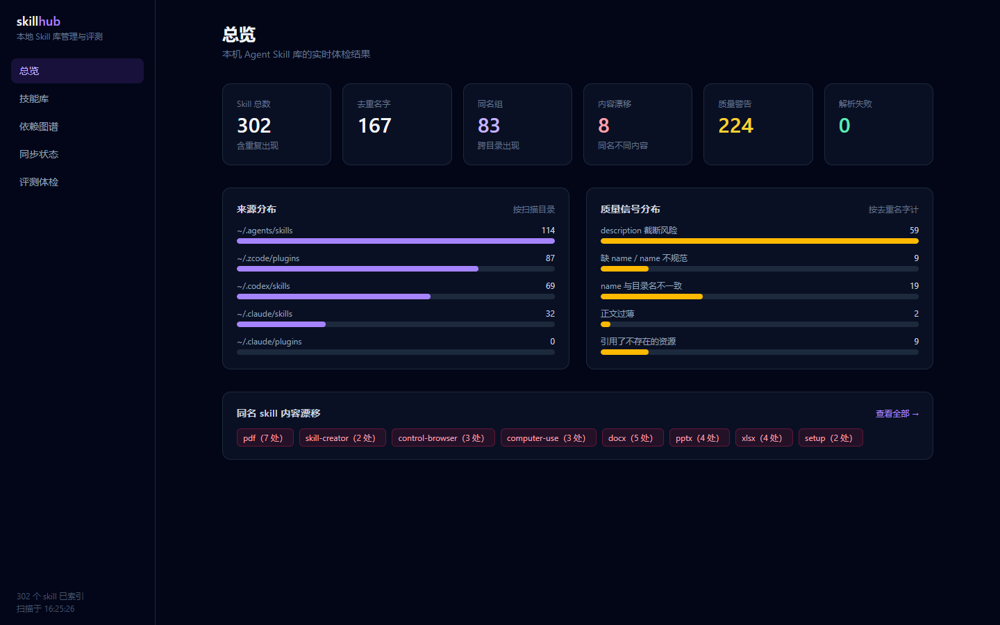
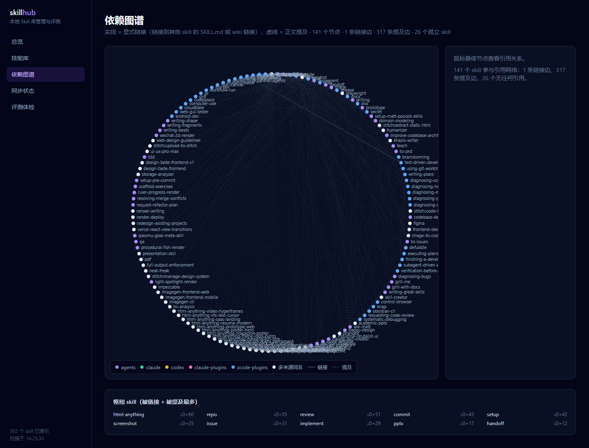

# skill-hub

[](https://github.com/Carlostang050311/skill-hub/actions/workflows/ci.yml)

[中文](README.md) | [English](README.en.md)

Local-first management & evaluation platform for AI agent skills: turn skills scattered across multiple agent directories into a metadata database with an executable evaluation loop.



## Why

A skill is essentially frontmatter (name/description) + instruction body + resource files. There are only three fundamental problems around it: **discovery** (what do I have, which one fits), **quality** (no feedback signal), and **distribution** (how to install it into N agent directories and keep them in sync). Existing tools only solve distribution (skills.sh etc.); skill-hub adds local inventory management, cross-directory drift detection, and quality evaluation — evaluation is the moat: static lint catches format issues, model-based evaluation catches semantic ones.

## Features

- **Indexing**: scans `~/.agents/skills`, `~/.claude/skills`, `~/.codex/skills` and Claude/ZCode plugin caches; parses frontmatter, content fingerprints for dedup, static quality signals (description truncation risk, missing resource refs, name conventions), explicit references + in-body mentions as two dependency signals
- **Web UI** (Next.js 15): inventory and task recommendations, usage cards, dependency graph, file diffs and backup restore, repair preview, evaluation workbench, comparable version reports and three workflow packs.
- **Evaluation framework**: scenario YAML (positive/negative trigger cases) → `plan` generates jobs → model runs them (ZCode subagents or OpenAI-compatible API) → `ingest` scores three layers into SQLite (trigger 40% + clarity 30% + static 30%); **exec-level evaluation** (`exec`) makes skills actually work in an isolated working directory, double-judged independently. Exec-level evaluation should only run on trusted local skills: it does not provide an OS-level sandbox, and skills from unfamiliar sources (GitHub, plugin caches) should be reviewed before execution.
- **Distribution**: directory fingerprints cover scripts and resources, with Markdown line-ending normalization. Preview with `diff`, retain originals on overwrite, restore with `backups/restore`, and reject stale previews. Windows cross-volume backups are supported.
- **GitHub ecosystem**: `github-install <owner/repo>` (discover SKILL.md → dedup → install → record origin), `origins` registry, `outdated-remote` compares directory fingerprints against upstream (`--apply` to update); `search-remote` searches the whole skills.sh ecosystem, `adopt` brings a discovered skill into local management
- **Agent-facing lookup**: `recommend "<task>"` ranks skills for a task description, plus the `skill-finder` meta-skill; an optional ZCode hook (`scripts/hook/prompt-recommend.mjs`) proactively injects recommendations on every user message



## Quick start

```bash
npm install
npm run build
npm test                       # full Vitest suite

npm run skillhub -- scan       # scan all local skill directories
npm run skillhub -- list       # list all skills
npm run skillhub -- recommend "turn this article into Xiaohongshu cards"

npm run start -w @skillhub/web # Web UI → http://localhost:3457
```

See the [Chinese README](README.md) for the full command reference (evaluation, GitHub install, distribution).

Node.js 24 is recommended (`node:sqlite` included). `SKILLHUB_HOME` isolates inventory and state for CLI, MCP and Web. Local management and ZCode job exchange work offline; remote APIs and GitHub/skills.sh queries require network access.

## Repair and evaluation loop

```bash
npm run skillhub -- diff demo --from agents --to claude
npm run skillhub -- backups
npm run skillhub -- restore <backup-id>
npm run skillhub -- repair-preview demo --from claude --file edited-SKILL.md
npm run skillhub -- repair demo --from claude --file edited-SKILL.md --expected-hash <preview-hash>
npm run skillhub -- recommend "create academic slides" --client codex
npm run skillhub -- kits research
npm run skillhub-eval -- plan --from claude --names demo
```

At `/workbench`, select a specific copy, scenario, backend and model. Run an OpenAI-compatible API batch or download ZCode jobs as JSONL and import results. Progress, cancellation, retry, local scenario editing and Markdown/HTML export are available. API credentials come from the process environment (`SKILLHUB_API_KEY`); the UI and task files do not store keys.

Development and production servers bind to `127.0.0.1`; mutation routes verify the local Host and page origin. `/eval` highlights similar descriptions in amber for trigger-boundary review. Invalid scenario or backup files are reported individually and preserved while healthy records remain usable. Restore a missing target through the sync preview or `skillhub restore <id> --target-missing`. This option conflicts with `--expected-hash` and refuses to overwrite a target that reappears.

Overall scores require every expected job to be valid. Weights remain trigger 40%, clarity 30%, static 30%; missing layers are never reweighted. Results bind to copy, directory and scenario fingerprints. Changed skills are stale; legacy reports are unbound. Version comparisons require the same copy, scenarios, model and backend.

Workbench views and downloaded reports recheck current skill and scenario versions. Stale results omit current overall scores while historical task files remain unchanged. Every execution plan creates a separate `run-*` directory, retaining previous artifacts without accepting them as a new run's output.

Execution evaluation reads actual artifacts and runs declared checks. A model assertion alone cannot prove an artifact exists. A working directory is not OS security isolation. See [artifact checks](docs/exec-checks.md), [usage cards](docs/usage-cards.md), [failure cases](docs/cases/README.md) and [acceptance evidence](docs/implementation-acceptance.md).

## Install from skills.sh

`skill-finder` is listed on the skills.sh directory; install it with the skills CLI:

```bash
npx skills add Carlostang050311/skill-hub
```

Repo page: [skills.sh/Carlostang050311/skill-hub](https://www.skills.sh/Carlostang050311/skill-hub)

## MCP server

```bash
npm run skillhub -- recommend "turn this article into Xiaohongshu cards"   # CLI lookup
```

Expose the library to coding agents over the standard MCP protocol:

```json
{
  "mcpServers": {
    "skill-hub": {
      "command": "node",
      "args": ["/path/to/skill-hub/packages/mcp/dist/server.js"]
    }
  }
}
```

Three tools: `recommend_skills` (task → ranked recommendations), `get_skill` (details + body), `library_stats` (inventory stats). The `skills/skill-finder` meta-skill defines the agent's decision rules. Set the `SKILLHUB_HOME` environment variable to point at a custom home directory (defaults to the real one).

## Public leaderboard

[skill-hub leaderboard](https://carlostang050311.github.io/skill-hub/leaderboard/) shows evaluation records and verification status. Data is generated by `npm run skillhub-eval -- export` from the local evaluation store (docs/leaderboard/). Unbound historical scores do not prove current quality; the public leaderboard was not republished for this delivery.

## Historical numbers

Earlier snapshot of 318 local skill records (models were not rerun for this delivery):

- 7 evaluation rounds, ~1,700 jobs total, 184 skills publicly scored; 100% trigger accuracy, zero false triggers
- Surfaced missing descriptions, self-contradicting bodies, mismatched dependencies, hardcoded paths — including bugs in skill-hub's own skills
- Exec-level evaluation: 11 skills actually worked in sandboxes, double-judged, all rubrics passed
- Upstream check caught real updates in third-party repos

Legacy scores lack complete directory/scenario binding and program-check evidence. They are labeled as historical unverified results and do not prove current quality. Current CLI, test and browser evidence is documented in the acceptance record; local protocol fixture scores validate workflow only.

## Architecture

npm workspaces monorepo, TypeScript throughout:

```
packages/core   indexing / parsing / fingerprints / quality / graph / distribution / github / recommend
packages/cli    skillhub CLI
packages/mcp    MCP server (recommend_skills / get_skill / library_stats)
apps/web        Next.js 15 + Tailwind v4 dashboard
apps/eval       evaluation runner (incl. exec-level + generator) + node:sqlite report store
scripts/hook    ZCode UserPromptSubmit proactive-recommendation hook
```

## License

[MIT](LICENSE)
