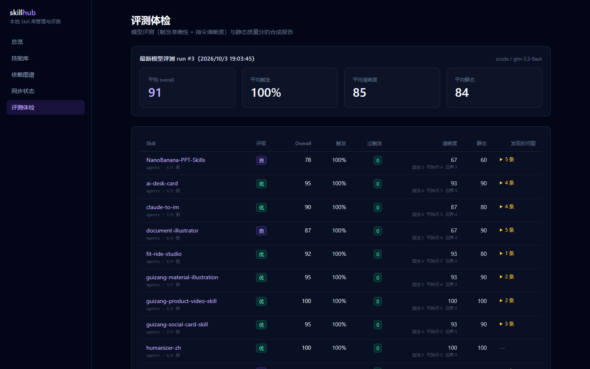

# skill-hub

[](https://github.com/Carlostang050311/skill-hub/actions/workflows/ci.yml)

[中文](README.md) | [English](README.en.md)

本地优先的 Agent Skill 管理与评测平台：把散落在多个 agent 目录的 skill 变成带元数据的数据库 + 可执行的评测闭环。


## 为什么

Skill 本质 = frontmatter（name/description）+ 正文指令 + 附属资源文件。围绕它只有三个根本问题：**发现**（我有什么、哪个适用）、**质量**（好不好用没信号）、**分发**（怎么装进 N 个 agent 目录并保持同步）。市面工具只做了分发（skills.sh 等）；skill-hub 补上本地库存管理、跨目录同步检测与质量评测——评测是护城河：静态 lint 抓格式问题，模型评测抓语义问题。

## 功能

- **索引**：扫描 `~/.agents/skills`、`~/.claude/skills`、`~/.codex/skills` 与 Claude/ZCode 插件缓存，解析 frontmatter，内容指纹去重、静态质量信号（description 截断风险、缺失资源引用、name 规范等）、显式引用 + 正文提及两路依赖信号
- **Web UI**（Next.js 15）：总览、技能库与任务推荐、使用卡片、依赖图谱、文件差异与备份恢复、指导书修复预览、评测操作台、版本对比与三类场景技能包。
- **评测框架**：scenario YAML（触发正/反用例）→ `plan` 生成作业 → 模型端跑批（ZCode 子代理或 OpenAI 兼容 API）→ `ingest` 三层评分入库（触发 40% + 清晰度 30% + 静态 30%）；**执行级评测**（`exec`）让 skill 在隔离工作目录真实干活，双评审独立复核。执行级评测只应在受信任的本地 skill 上运行：它不提供操作系统级沙箱，对陌生来源（GitHub、插件缓存）的 skill 应先审阅内容再执行。
- **分发同步**：完整目录指纹覆盖脚本与资源；Markdown 归一化行尾。`diff` 预览逐文件差异，覆盖保存原件，`backups/restore` 恢复；预览后内容变化时拒绝覆盖。支持 Windows 跨盘备份。
- **GitHub 生态**：`github-install <owner/repo>`（发现 SKILL.md → 查重 → 安装 → 登记来源）、`origins` 上游注册表、`outdated-remote` 目录指纹对比上游（`--apply` 一键更新）；`search-remote` 直接搜 skills.sh 全生态，`adopt` 把搜到的 skill 收编进本机管理体系
- **agent 查库**：`recommend "<任务描述>"` 按任务推荐 skill（中英文关键词 + 质量信号参与排序），配套 meta-skill `skill-finder` 让编码代理干活前自动查库（随仓库 `skills/` 目录分发）；可选 `scripts/hook/prompt-recommend.mjs`（ZCode UserPromptSubmit hook）在每条用户消息时主动注入推荐


## 快速开始

```bash
npm install
npm run build
npm test                       # Vitest 全量测试

npm run skillhub -- scan       # 扫描本机全部 skill 目录
npm run skillhub -- list       # 列出全部 skill
npm run skillhub -- recommend "把这篇文章做成小红书图文卡片"

npm run start -w @skillhub/web # Web UI → http://localhost:3457
```

更多命令见 [README 使用手册](README.md#快速开始)：评测、GitHub 安装、分发同步。

推荐使用 Node.js 24（包含 `node:sqlite`）。`SKILLHUB_HOME` 可让 CLI、MCP 和 Web 共用独立库存及状态目录。管理与 ZCode 作业交换可以离线运行；远程模型 API 和 GitHub/skills.sh 查询需要网络。

## 同步、修复与评测闭环

```bash
npm run skillhub -- diff demo --from agents --to claude
npm run skillhub -- backups
npm run skillhub -- restore <backup-id>
npm run skillhub -- repair-preview demo --from claude --file edited-SKILL.md
npm run skillhub -- repair demo --from claude --file edited-SKILL.md --expected-hash <preview-hash>
npm run skillhub -- recommend "制作学术幻灯片" --client codex
npm run skillhub -- kits research
npm run skillhub-eval -- plan --from claude --names demo
```

Web `/workbench` 可选择具体副本、用例、后端和模型，运行 API 跑批或下载 ZCode 作业 JSONL 再导入结果；支持进度、取消、失败重试、Markdown/HTML 导出及本地正反例编辑。API 使用进程中已有的 `SKILLHUB_API_KEY`、`SKILLHUB_MODEL`、`SKILLHUB_BASE_URL`，页面和任务文件不保存密钥。

Web 开发与生产服务默认仅监听 `127.0.0.1`，写入接口检查本地 Host 与页面来源。`/eval` 用黄色列表提醒描述相近的技能，方便核对触发边界。坏用例或备份清单会单独提示并保留原文件，正常记录仍可使用。目标目录移走后可在同步页预览恢复，或执行 `skillhub restore <id> --target-missing`；该选项与 `--expected-hash` 互斥，目标重新出现时拒绝覆盖。

完整总分要求作业全部有效，权重固定为触发 40% + 清晰度 30% + 静态 30%。缺失或无效结果不重新分配权重。成绩绑定具体副本、完整目录和用例指纹；技能变动标为过期，旧报告标为未绑定。版本对比限制相同副本、用例、模型与后端，仍需结合实际输出判断修复效果。

操作台和下载报告都会复核当前技能及用例版本，过期结果隐藏当前总分，历史任务原件保留。每轮执行评测创建独立的 `run-*` 目录，保留旧现场，避免旧产物冒充本轮产出。

执行级评测会读取真实文件并执行声明的程序检查，不能仅凭模型声称产物存在判定通过。工作目录不是操作系统安全隔离；执行可信技能时自行选择运行环境。见 [产物检查](docs/exec-checks.md)、[使用卡片元数据](docs/usage-cards.md)、[失败案例库](docs/cases/README.md) 和 [本轮验收](docs/implementation-acceptance.md)。



## 从 skills.sh 安装

`skill-finder` 已收录到 skills.sh 目录，用 skills CLI 一条命令安装：

```bash
npx skills add Carlostang050311/skill-hub
```

仓库页：[skills.sh/Carlostang050311/skill-hub](https://www.skills.sh/Carlostang050311/skill-hub)

## 让 agent 自己查库（MCP server）

```bash
npm run skillhub -- recommend "把这篇文章做成小红书图文卡片"   # CLI 直接查
```

也可以把 skill-hub 作为 MCP server 接进 Claude Code / ZCode 等客户端，agent 干活时自动查库：

```json
{
  "mcpServers": {
    "skill-hub": {
      "command": "node",
      "args": ["/path/to/skill-hub/packages/mcp/dist/server.js"]
    }
  }
}
```

暴露三个工具：`recommend_skills`（任务→推荐）、`get_skill`（详情+正文）、`library_stats`（库统计）。配套 meta-skill `skills/skill-finder` 定义了 agent 的查库决策规则。设 `SKILLHUB_HOME` 环境变量可指向自定义主目录（默认本机）。

## 公开质量榜

[skill-hub 质量榜](https://carlostang050311.github.io/skill-hub/leaderboard/)展示评测记录和验证状态。数据由 `npm run skillhub-eval -- export` 从本地评测库生成（docs/leaderboard/data.json + 静态页）；历史未绑定数据不代表当前质量，本轮没有重新发布榜单。

## 历史运行数据

此前本机 318 条 skill 记录的历史快照（未经本轮重新跑模型）：

- 7 轮评测、累计约 1700 个作业，184 个 skill 有公开评分；触发准确率 100%、零过触发
- 抓出 description 缺失、正文自相矛盾、依赖不匹配、硬编码路径等真实缺陷（含 skill-hub 自己的 skill）
- 执行级评测 11 个 skill 在沙箱真实干活，双评审独立复核全部满分
- 上游检测抓到第三方仓库的真实更新

这些旧成绩没有完整目录/用例绑定和程序验收记录，界面将其标为历史未验证数据，不代表当前版本质量。本轮真实目录扫描、自动测试及浏览器证据见验收文档；本地协议夹具的分数仅用于验证流程。

## 架构

当前架构审查、领域模型、评测契约和威胁边界见：[2026-10-23 审查与路线](docs/review-2026-10-23.md)、[领域模型](docs/domain-model.md)、[评测契约](docs/evaluation-contract.md)、[威胁模型](docs/threat-model.md)。这些文档区分了已验证能力、历史证据和下一阶段计划。

npm workspaces monorepo，TypeScript 全栈：

```

packages/storage 共享库存快照（inventory.db）与 schema migrations
packages/core   索引/解析/指纹/质量信号/图谱/分发/GitHub/推荐
packages/cli    skillhub 命令行
packages/mcp    MCP server（recommend_skills / get_skill / library_stats）
apps/web        Next.js 15 + Tailwind v4 仪表盘
apps/eval       评测 runner（含执行级 + 生成器）+ node:sqlite 报告库
scripts/hook    ZCode UserPromptSubmit 主动推荐 hook
```

## License

[MIT](LICENSE)
