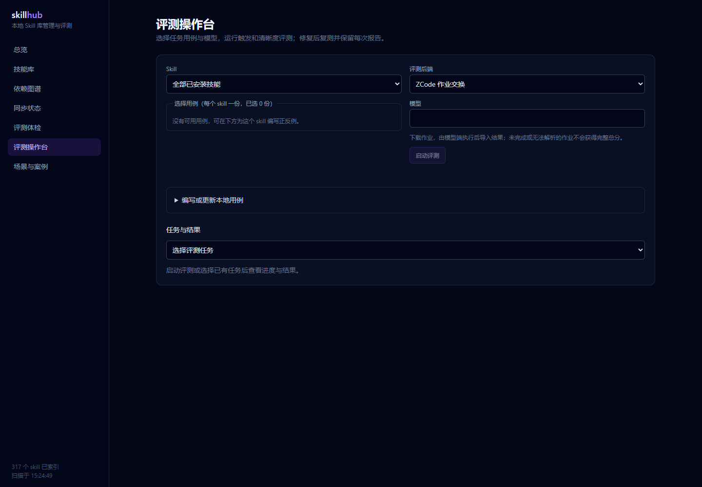
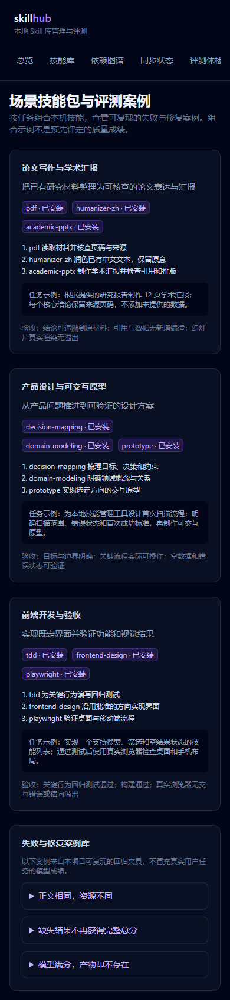
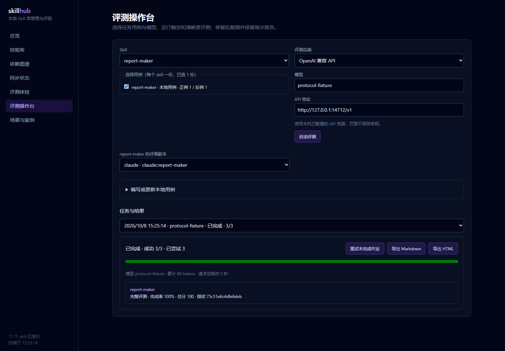

# 完善计划与验收记录

目标：完成 2026-10-08 讨论的全部建议，保留本地优先、Windows/Node 和现有仪表盘方向。

交付状态：功能完成，本地验收通过；真实外部模型质量跑批未执行。功能提交 `c24fbe4`，分支 `codex/complete-local-workbench`。

交接后续：已补齐重叠提示并关闭代码审查中的故障；最新验收为 31 文件 / 158 用例、17 项真实浏览器/CLI/Hook 流程通过。详见 [后续开发与审查记录](review-2026-10-08.md)，下文保留首轮六模块交付证据。

## 模块与验收标准

| 模块 | 可验证结果 | 状态 |
| --- | --- | --- |
| 完整目录同步 | 正文相同而资源变化可检测；文件差异预览；同步保留备份；恢复原目录；并发修改时拒绝覆盖 | 完成，回归与浏览器通过 |
| 可信评测 | 缺失、解析失败、格式不符不出完整总分；完成率和错误明确；成绩绑定内容指纹；历史未绑定成绩有标识 | 已实现，回归通过 |
| 产物验收 | 读取真实产物；存在/非空/JSON/内容/Node 检查；拒绝路径越界；重复评审项不会抬高成绩；自动检查失败不能获得通过 | 已实现，回归通过 |
| Web 评测台 | 选择 skill、用例和模型；启动、进度、取消、失败原因、重试；API 与 ZCode 作业交换均可用；导出 Markdown/HTML | 完成，HTTP 协议与浏览器通过 |
| 推荐 | 中英文同义词、场景和客户端条件；固定任务集验证 top-k 与无关任务；CLI/MCP/Web 行为一致 | 已实现，协议与浏览器通过 |
| 修复闭环 | 展示警告与建议；编辑预览；应用前检查指纹并备份；复测；查看修改前后差异 | 已实现，浏览器通过 |
| 内容资产 | 三类场景技能包、可复现失败/修复案例、技能使用卡片；网页可访问且关联本机库存 | 已实现，桌面/手机渲染通过 |
| 集成交付 | npm test 全绿；npm run build；真实目录 CLI；真实浏览器桌面/移动端及交互验收；更新双语 README；git commit | 完成，本地验收通过并提交 |

## 边界与实现决策

- 不修改认证凭据、CI/CD 或数据库 schema；新评测元数据沿用报告 JSON。
- 不发布、push 或安装全局依赖。
- 同步和修复的覆盖通过备份目录保存原件；真实用户 skill 目录仅用于只读验收，写入流程使用独立验收目录。
- 新页面复用现有配色与组件，不改变视觉方向。
- 工作区已有碰撞检测、CLI 正文预取和 hook 改动，先保存快照，保留原有意图；必要的构建/测试兼容修复单独说明。
- 远程模型评测验收需要已配置的 provider；本地 HTTP 测试服务只能证明协议与状态流程，不能作为真实模型质量成绩。

## 基线

2026-10-08：`npm test`，22 个文件通过、108 个测试通过，hook suite 因 `.mjs` 混入 TypeScript interface 语法无法解析。后续修复该集成问题，保留跳过自家仓库与预取逻辑。

## 验收证据

环境：Windows、Node.js v24.14.0、Next.js 15.5.27、Microsoft Edge / Playwright；日期 2026-10-08。

### 自动测试与构建

- `npm test`：30 个测试文件，144 个测试全部通过（15:22:54，6.68 秒）。覆盖资源漂移、二进制与文件重命名、dist 资源、旧资源恢复、预览后变化、跨卷失败回滚、修复身份保护、评分完整性、所选副本绑定、用例/副本消失、HTTP 跑批/取消/重试/重启恢复、坏任务文件隔离、真实文件与 Node 程序检查、版本对比、推荐与 MCP stdio 集成。
- `npm run build`：core、CLI、eval、MCP 的 TypeScript 构建及 Next.js 生产构建均通过。Next.js 包含全部页面与 5 条本地 API 路由。
- `node --check scripts/hook/prompt-recommend.mjs`：语法检查通过。
- `git diff --check`：通过；修改及新增的文本源文件均为 LF。

固定推荐任务集共 8 条，top-1 命中 8/8（因此 top-5 也为 8/8）；包含中英文演示文稿、文章润色、视频切片、测试驱动、浏览器验收与原型任务。两条无关任务返回空结果；明确客户端不兼容时排除，未声明时标为未知。该小型回归集不是开放领域推荐质量评估。

### 真实本机库存（只读）

`node packages/cli/dist/cli.js scan`：317 条有效记录、183 个去重名字、83 个同名组、8 个漂移组、233 条警告、3 个解析失败。来源分别为 agents 131、claude 33、codex 69、ZCode 插件 84。在同一进程中连续三次扫描均为 317/3，统计稳定。

失败来自已有第三方插件 `browser-use` 的 0.3.1、0.4.2、0.5.1 三个版本中 `skills/web-gui-tester/SKILL.md`，description 的未引用冒号导致 YAML `incomplete explicit mapping pair`。没有修改插件缓存。初次旧代码报告 319/1：gray-matter 在解析前缓存坏对象，把后两个内容相同的坏文件误计入库存；本轮关闭该缓存路径并新增重复坏 YAML 回归。

### 浏览器与可复现命令

```bash
# 终端 1：真实库存，只读页面验收
npm run start -w @skillhub/web
# 终端 2：隔离验收目录 + 本地 OpenAI 协议服务 + Web :3458
node scripts/acceptance/serve-fixture.mjs
# 等两项显示 Ready 后，终端 3：真实 Edge 自动操作
node scripts/acceptance/verify-browser.mjs
```

脚本把夹具、备份、页面截图和 `browser/evidence.json` 保存在 `.skillhub/acceptance-*`，不删除验收现场。跨盘备份另保存在系统临时目录。夹具中的 API 凭据仅是本地协议字符串，不使用真实认证信息。

最终一轮：2026-10-08 15:24–15:25，9 项流程检查全部通过，16 张真实库存视口截图，无 console error 或 pageerror。原始证据位于 `.skillhub/acceptance-Qd5QWo/browser/evidence.json`；随仓库保留 [浏览器摘要](acceptance/browser-2026-10-08.json) 与 [真实 CLI 摘要](acceptance/cli-2026-10-08.json)。







真实库存检查总览、技能库、PDF 详情、图谱、同步、体检、操作台、场景案例共 8 页面；分别采用 1440×1000 和 390×844 视口，截图并检查页面横向溢出。写入流程全部使用隔离库存：同步预览→应用→恢复，编辑 Claude 副本→预览→备份→同副本复测→版本对比，API 429→失败详情→重试，在途取消，ZCode 下载/导入，本地用例保存，Markdown/HTML 导出，真实跨盘备份，以及 CLI 执行产物 JSON 验收后资源改动产生 stale。

初轮浏览器检查发现并修复：127.0.0.1 与 Next 内部 localhost 的来源校验差异；HTTP 200 的失败任务 error 字段被误当请求错误；配置加载期间提前输入的模型被默认值覆盖。均已补回归或真实流程验证。

### 评审与保留边界

独立工程规范与需求覆盖评审发现的跨卷、坏任务恢复、副本复测、执行成绩指纹、不可比版本及消失项丢失问题已修复并复核关闭。初始未提交的碰撞检测、正文预取及 hook 工作保留并集成；修复其类型/JavaScript 语法兼容及 Windows 文件 URL 路径处理，没有覆盖原功能意图。

未执行真实外部模型质量跑批：本机没有配置真实 API 凭据。API 验收使用实际 HTTP 协议夹具；ZCode 验收使用实际作业文件交换和结果导入。夹具总分变化只证明流程与绑定正确，不能作为实际模型或技能质量提升的证据。旧榜单数据没有重新跑测或发布。工作目录只是输出边界，不提供操作系统隔离。
