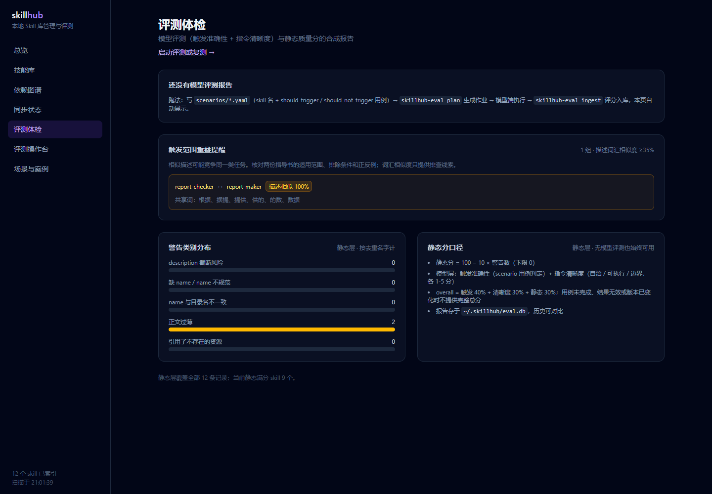
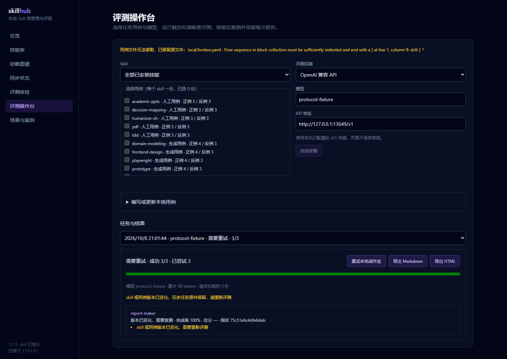

# 交接后续开发与代码审查（2026-10-08）

已阅读项目 `AGENTS.md` 和系统临时目录中的 `skillhub-handoff-20261008.md`。交接文档停在 `09d24c7`；当前六模块交付已包含在 `c24fbe4` 与 `390d2c0`，本轮核对旧遗留项并修复审查发现的实际故障。

工程规范与需求覆盖分别独立审查 `09d24c7..390d2c0`，修复后再对工作树定向复核。下列问题均已关闭。

| 问题 | 修复与验证 |
| --- | --- |
| P1：远程 Host/Origin 可绕过写入来源检查，默认服务监听所有地址 | 开发/生产服务绑定 `127.0.0.1`；限制本地 Host、端口及同源 Origin。单元回归和真实 HTTP 伪造请求均拒绝。 |
| P1：持续磁盘错误产生未处理后台 rejection | 失败状态和脱敏错误留在内存可查询；最后一次写入失败不逸出后台任务，清理 Promise 的两个分支。持续 EIO 回归通过。 |
| P2：任务首次保存失败留下无法取消/重试的运行中记录 | 保存成功后才注册任务；失败信息脱敏，启动失败不留幽灵任务。写盘恢复后可再次启动。 |
| P2：写了一半的备份清单或一个坏清单令全部恢复失效 | `backup.pending` 写完后原子发布；失败回滚目录；坏清单单独报告并保留，正常备份可使用。覆盖同卷/跨卷故障和日期结构校验。 |
| P2：技能移走后，完整备份也无法恢复 | Web 支持空目标预览；核心显式 `null` 指纹校验；CLI 提供 `--target-missing`，与 `--expected-hash` 互斥。目标重新出现时拒绝覆盖。 |
| P2：无关坏 YAML 阻断全库配置和正常任务评分 | 按文件隔离、显示错误、保留原文件。正常任务完成；自己的用例损坏仍标为 stale。 |
| P2：重复执行沿用同一目录，旧产物冒充新轮输出 | 每轮建立独立 `run-*` 目录；保留旧现场。第二轮无产物时，即使评审声称通过也被程序验收拒绝。 |
| P2：操作台及导出继续把历史成绩标为当前完整 | 详情、摘要、Markdown/HTML 导出均复核技能和用例指纹；stale 隐藏当前总分。历史任务文件和原始分数不修改。 |
| P2：未选择的技能副本消失也阻断本次评测 | 仅校验当前用例所选副本；当前所选副本缺失仍明确拒绝。 |

补齐 handoff 的 `/eval` 黄色重叠提示：复用 core/CLI 的描述词汇检测，展示技能链接、相似度和共享词。它提供触发边界排查线索。真实 Hook 子进程验证普通输入注入及正文预取、子代理/自家仓库零输出和重复抑制。

## 验收记录

- 最终 `npm test`：31 个文件、158 个用例全绿，21:03:06 开始，7.06 秒。新增故障用例先复现失败，再验证修复。
- `npm run build` 全部包与 Web 生产构建通过；最后两项修复后再次构建 CLI、eval 和 Web，全部通过。
- `git diff --check`、三个验收/Hook 脚本的 `node --check` 通过；本轮修改文本均为 LF。
- 真实 Edge/Playwright：17 项流程检查通过，8 页面 × 桌面/手机共 16 个视口截图，无页面横向溢出、console error 或 pageerror。原始证据 `.skillhub/acceptance-E1epBu/browser/evidence.json`，仓库摘要见 [浏览器与 CLI 证据](acceptance/browser-review-2026-10-08.json)。
- 真实本机 CLI 库存稳定：317 条有效记录、183 个名字、83 个同名组、8 个漂移组、233 条警告、3 个已有第三方 YAML 解析失败。没有修改真实 skill 库或插件缓存。
- 写入验收使用隔离库存；跨盘备份使用实际 C: 与 F:。本轮夹具、移走的目标、坏文件和备份现场均保留。

首轮验收的 Hook 夹具把 `cwd` 放在仓库内部，正确触发跳过规则，导致测试预期失败。已修正为外部项目路径并使用新夹具重跑；失败现场保留在 `.skillhub/acceptance-C4EieE`。首次全量测试有一个已有本地 Git 用例超过默认 5 秒；未放宽超时，单独定位及后续两次全量运行通过。

真实外部模型质量跑批仍未执行：本机实际服务 `configured=false`。本地 HTTP 夹具验证状态、协议与版本绑定，不作为真实模型质量成绩。没有 push、发布、修改认证凭据、CI/CD 或数据库 schema。
